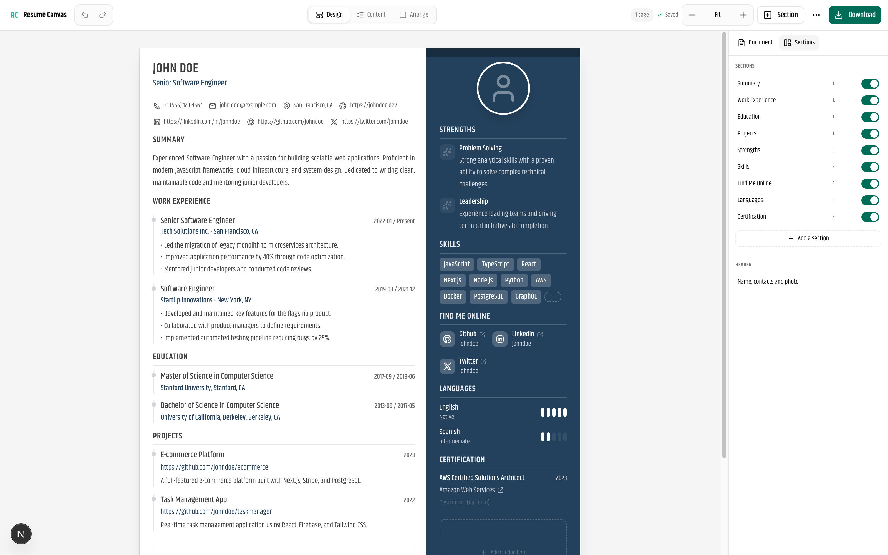
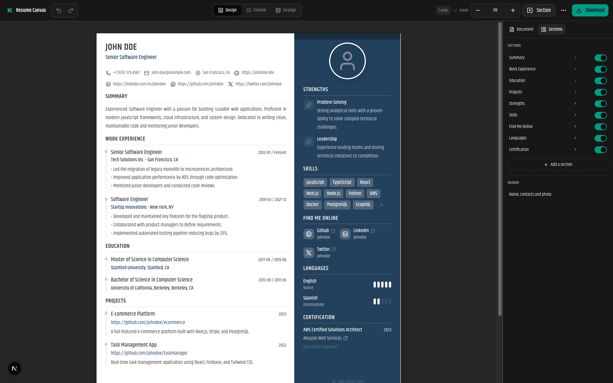

# Resume Canvas 📄

<div align="center">



<p align="center">
  <a href="#features">Features</a> •
  <a href="#tech-stack">Tech Stack</a> •
  <a href="#getting-started">Getting Started</a> •
  <a href="#contributing">Contributing</a> •
  <a href="#license">License</a>
</p>

[](https://opensource.org/licenses/MIT)


</div>

## 🚀 Overview

**Resume Canvas** is a modern, open-source resume builder designed to be simple, fast, and privacy-focused. Build your professional resume in minutes with a real-time preview and export it as a high-quality PDF.

Unlike other resume builders, **Resume Canvas** runs entirely in your browser. Your data never leaves your device unless you choose to share it. No sign-ups, no paywalls, no tracking.

## ✨ Features

- **👀 Live, paginated preview:** Edit directly on the page and see exactly where each page breaks.
- **🎨 Six templates:** Classic (filled sidebar), Modern Sidebar, Clean (ATS-first), Minimal, Executive and Compact. A template is only a starting point; everything stays editable.
- **🔤 Typography and spacing that work:** 19 font pairings, text size, line spacing, heading hierarchy, weight and case, plus Compact / Normal / Spacious density with per-level fine-tuning.
- **🤖 ATS tools:**
  - A scored checklist covering contact details, dated roles, bullet quality, quantified results, standard headings, layout and length.
  - Paste a job description to see which of its keywords you already cover.
  - An **ATS-safe PDF** that re-flows the same content into one clean column for job portals.
- **📄 Exports:** Designed PDF, ATS-safe PDF, Word (`.docx`) and plain text. PDFs are printed by the browser from the preview itself, so they match the editor exactly, with selectable text in reading order.
- **🔒 Privacy first:** Your resume is stored locally in your browser and never uploaded as you write.
- **🔗 Share links:** Send a read-only link. The resume is encrypted in the browser and the key travels in the URL fragment, so the server stores a blob it cannot read. Links expire on a schedule you choose.
- **🧩 Drag & drop:** Reorder sections and move them between columns and pages.
- **🌗 Dark/light mode** and a mobile-friendly editor.

## 📸 Screenshots

|                             Light Mode                             |                            Dark Mode                             |
| :----------------------------------------------------------------: | :--------------------------------------------------------------: |
|  |  |

## 🛠️ Tech Stack

- **Framework:** [Next.js 16](https://nextjs.org/) (App Router)
- **Language:** [TypeScript](https://www.typescriptlang.org/)
- **Styling:** [Tailwind CSS 4](https://tailwindcss.com/)
- **UI Components:** [Shadcn/UI](https://ui.shadcn.com/) & [Lucide React](https://lucide.dev/)
- **State Management:** [Zustand](https://github.com/pmndrs/zustand) with [zundo](https://github.com/charkour/zundo) for undo/redo
- **PDF:** the browser's own print engine, driven by the paginated preview
- **Word export:** [docx](https://docx.js.org/)

## 🏁 Getting Started

Follow these steps to set up the project locally on your machine.

### Prerequisites

- Node.js 18+ installed
- pnpm (recommended), npm, or yarn

### Installation

1.  **Clone the repository:**

    ```bash
    git clone https://github.com/kstmostofa/resume-canvas.git
    cd resume-canvas
    ```

2.  **Install dependencies:**

    ```bash
    pnpm install
    # or
    npm install
    ```

3.  **Configure share links (optional locally, required in production):**

    ```bash
    cp .env.example .env.local
    ```

    Point it at any Upstash-compatible Redis REST endpoint. Left blank, the
    app falls back to an in-process store so sharing still works while you
    develop; a production build refuses to create links without it rather
    than handing out ones that would silently break.

4.  **Run the development server:**

    ```bash
    pnpm dev
    # or
    npm run dev
    ```

5.  **Open your browser:**
    Navigate to [http://localhost:3000](http://localhost:3000) to see the application running.

## 🤝 Contributing

Contributions are what make the open-source community such an amazing place to learn, inspire, and create. Any contributions you make are **greatly appreciated**.

1.  Fork the Project
2.  Create your Feature Branch (`git checkout -b feature/AmazingFeature`)
3.  Commit your Changes (`git commit -m 'Add some AmazingFeature'`)
4.  Push to the Branch (`git push origin feature/AmazingFeature`)
5.  Open a Pull Request

## 📄 License

Distributed under the MIT License. See `LICENSE` for more information.

## 🙏 Acknowledgments

- [Shadcn/UI](https://ui.shadcn.com/) for the beautiful component library.
- [docx](https://docx.js.org/) for Word document generation.
- [Lucide](https://lucide.dev/) for the clean icons.

---

<div align="center">
  Made with ❤️ by <a href="https://github.com/kstmostofa">Md Mostafijur Rahman</a>
</div>
